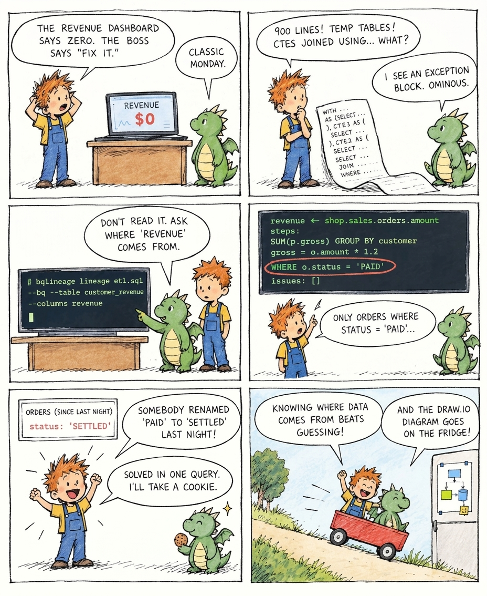

# bqlineage



Table- and column-level lineage for BigQuery SQL. Give it a query, a script, or a folder of them, and it tells you:

- which tables feed which
- where every column's values come from
- how each column was built, step by step, including the JOIN / WHERE / GROUP BY logic

It handles CTEs, temp tables, views, `MERGE`, procedural blocks, templates and dynamic SQL. Columns are matched against real table schemas, never guessed, and problems in the SQL are reported.

## Install

```bash
python -m venv .venv
.venv\Scripts\python -m pip install -e ".[bq]"
```

Requires Python 3.11+. On Mac or Linux, use `.venv/bin/python`.

## Quick start

```bash
bqlineage auth                                        # once: log in to Google Cloud
bqlineage catalog sync --project my-proj --region us  # once: cache every table's schema in ./bqlineage.db

bqlineage lineage etl.sql --table dw.fact --columns total    # where dw.fact.total comes from, and how
bqlineage validate etl.sql --dry-run                         # problems in the SQL, plus BigQuery's own check
bqlineage scan etl/ && bqlineage trace dw.fact.total         # lineage across all your scripts
```

Settings you'd otherwise repeat go in `bqlineage.toml`:

```toml
project = "my-proj"
region = "us"
bq = true          # fetch tables the catalog doesn't have yet
[vars]
env = "prod"       # fills {{ env }} / ${env} in templated SQL
```

## Documentation

- [Reading the output](docs/output.md): the JSON, a worked example, and what each part means
- [Command line](docs/cli.md): every command and option, and `bqlineage.toml`
- [Schema catalog](docs/catalog.md): sync, refresh, offline use, multiple projects
- [Variables and dynamic SQL](docs/variables.md): templates, script constants, `EXECUTE IMMEDIATE`
- [Scanning and trace](docs/scanning.md): many scripts, lineage across them
- [Diagrams and OpenLineage](docs/exports.md): draw.io, Data Lineage API
- [How it works](docs/architecture.md): architecture, modules, tests

## Tests

```bash
.venv\Scripts\python -m pytest -q
```

No BigQuery access needed: the client is mocked.
