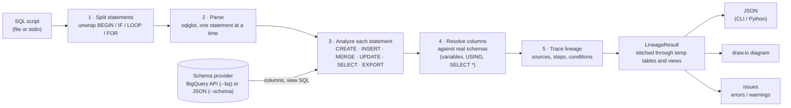
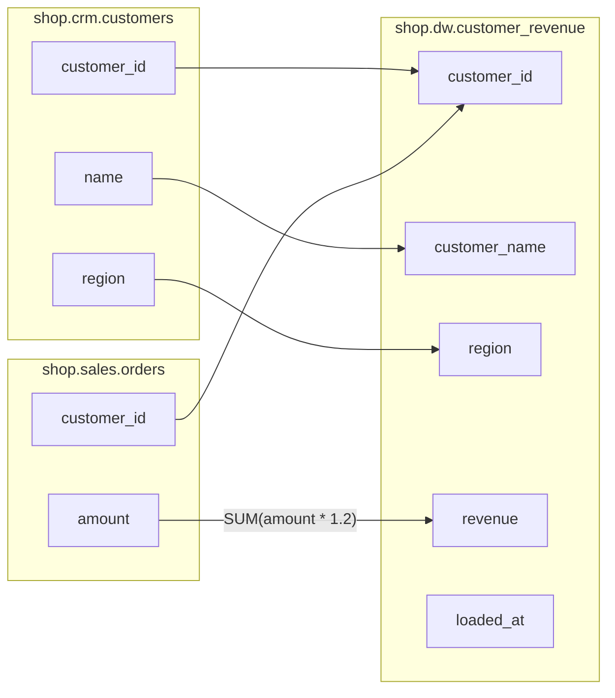

# bqlineage

Table- and column-level lineage for BigQuery SQL, built on [sqlglot](https://github.com/tobymao/sqlglot)'s BigQuery parser. Give it a query or a whole script and it tells you:

- which tables feed which
- where every target column's values come from
- how each column was built, step by step, including the JOIN / WHERE / GROUP BY logic along the way

It also flags problems in the SQL. The output is JSON, and optionally a draw.io diagram.

## How it works



| File | Role |
|---|---|
| `bqlineage/core.py` | Splits the script, analyzes each statement, resolves columns, traces lineage, builds `LineageResult` |
| `bqlineage/schema.py` | Schema providers: `BigQuerySchemaProvider` (live, via your gcloud login), `DictSchemaProvider` (JSON / tests) |
| `bqlineage/drawio.py` | draw.io export |
| `bqlineage/cli.py` | `bqlineage auth / validate / lineage` |

Columns are matched against real table schemas, never guessed. That's why lineage needs `--bq` (live schemas) or `--schema` (a JSON file). Without either, unqualified columns in joins can't be resolved, and you get warnings instead of lineage.

## Install

```bash
python -m venv .venv
.venv\Scripts\python -m pip install -e ".[bq]"
```

(On Mac or Linux, use `.venv/bin/python` instead of `.venv\Scripts\python`.)

## Example

[`examples/orders.sql`](examples/orders.sql) builds daily revenue per EU customer in two steps: a temp table of paid orders, then an INSERT that joins it to EU customers.

```sql
DECLARE run_date DATE DEFAULT CURRENT_DATE();

-- 1. Today's paid orders, with tax added
CREATE TEMP TABLE paid_orders AS
SELECT o.order_id, o.customer_id, o.amount * 1.2 AS gross
FROM `shop.sales.orders` o
WHERE o.status = 'PAID' AND DATE(o.order_ts) = run_date;

-- 2. Revenue per EU customer
INSERT INTO `shop.dw.customer_revenue` (customer_id, customer_name, region, revenue, loaded_at)
WITH eu_customers AS (
  SELECT customer_id, name, region
  FROM `shop.crm.customers`
  WHERE region = 'EU'
)
SELECT customer_id, c.name, c.region, SUM(p.gross), CURRENT_TIMESTAMP()
FROM paid_orders p
JOIN eu_customers c USING (customer_id)
GROUP BY customer_id, c.name, c.region;
```

```bash
bqlineage lineage examples/orders.sql --schema examples/schema.json --drawio examples/orders.drawio
```

The full output is in [`examples/orders.lineage.json`](examples/orders.lineage.json). Here is the part for one column:

```json
{
  "tables": {
    "shop.dw.customer_revenue": ["shop.crm.customers", "shop.sales.orders"]
  },
  "columns": {
    "shop.dw.customer_revenue.revenue": {
      "sources": ["shop.sales.orders.amount"],
      "indirect_sources": [
        "shop.crm.customers.customer_id", "shop.crm.customers.name", "shop.crm.customers.region",
        "shop.sales.orders.customer_id", "shop.sales.orders.order_ts", "shop.sales.orders.status"
      ],
      "steps": [
        {
          "column": "shop.dw.customer_revenue.revenue",
          "expression": "SUM(p.gross)",
          "from": ["_SESSION.paid_orders AS p", "eu_customers AS c"],
          "joins": ["JOIN c ON p.customer_id = c.customer_id"],
          "group_by": ["COALESCE(p.customer_id, c.customer_id)", "c.name", "c.region"]
        },
        {
          "column": "_SESSION.paid_orders.gross",
          "expression": "o.amount * 1.2",
          "from": ["shop.sales.orders AS o"],
          "where": "o.status = 'PAID' AND DATE(o.order_ts) = @run_date"
        }
      ]
    },
    "...": "one entry per target column"
  },
  "issues": []
}
```

### How to read it

**`tables`: which tables feed which.** `customer_revenue` is built from `orders` and `customers`. The temp table `paid_orders` doesn't appear: lineage is traced through it to the real tables. Add `--raw` to see temp tables (and views) as their own hops.

**`sources`: where a column's values come from.**

| Target column | `sources` | Why |
|---|---|---|
| `revenue` | `orders.amount` | `SUM(p.gross)`, and `gross` is `o.amount * 1.2` |
| `customer_id` | `orders.customer_id`, `customers.customer_id` | `USING (customer_id)` merges the key from both sides; the steps show it as `COALESCE(p.customer_id, c.customer_id)` |
| `customer_name` | `customers.name` | through the CTE `eu_customers` |
| `region` | `customers.region` | through the CTE `eu_customers` |
| `loaded_at` | *(empty)* | `CURRENT_TIMESTAMP()`: computed, not read from any table |

An empty `sources` list is never a silent failure. The first step's expression says what the value is: a constant, a function, or a script variable (shown as `@name`, like `@run_date`).

**`steps`: how the column was built.** Read them top to bottom as going back in time, from the target to the original table:

1. **`customer_revenue.revenue = SUM(p.gross)`**
   - `p` is the temp table `paid_orders`, joined to `eu_customers AS c` on `customer_id`.
   - Rows are grouped per customer.
2. **`paid_orders.gross = o.amount * 1.2`**
   - computed in the temp table
   - keeps only orders with `status = 'PAID'` placed on `@run_date`

Each step shows that query's `from`, `joins`, `where`, `group_by`, `having` and `qualify`, whichever it has. A step from a CTE also has `"in"`, naming the statement it belongs to; for example `eu_customers.name` has `"in": "shop.dw.customer_revenue"` and carries the `WHERE customers.region = 'EU'`.

**`indirect_sources`: what decides which rows exist.** These are the columns read by the joins, filters and grouping along the way:
- `orders.status` and `orders.order_ts` come from the temp table's WHERE.
- `customers.region` comes from the CTE's WHERE.
- Both `customer_id`s come from the join.
- `name` and `region` come from the GROUP BY.

They're the same for every column here because every column passes through the same join, filters and grouping. A column that went through a different path would list different ones.

**`issues`** is empty here. Otherwise it lists errors (definite problems in the SQL) and warnings (things the tool couldn't know, such as a missing table schema), each with its statement number and line.

### The diagram

`--drawio FILE` writes a file you can open in [draw.io / diagrams.net](https://app.diagrams.net) (desktop app or browser) or the VS Code draw.io extension. It has two pages:

- **Tables:** tables flow left to right. Sources are blue, targets green, and temp tables / views are grey dashed (with `--raw`).
- **Columns:** each table lists only the columns in the lineage, with arrows from source column to target column. **Hover a target column** to see how it was built: each step's expression with its JOIN / WHERE / GROUP BY, and the columns that decide its rows.

The Columns page for the example looks like this:



**Will it be too large?** The Tables page stays small. The Columns page grows with the number of columns. For example, a script with 20 source tables, 10 temp tables and 5 targets of 200 columns each (1,000 target columns) gives:

| What you export | File | Shapes | Arrows |
|---|---|---|---|
| Whole script, both pages | ~1 MB | 2,050 | 1,020 |
| Whole script with `--raw` (temp hops) | ~1.9 MB | 4,100 | 2,550 |
| `--table out0` | ~190 KB | 410 | 204 |
| `--table out0 --columns a,b` | ~5 KB | 12 | 6 |
| `--level table` | ~9 KB | 25 | 20 |

draw.io opens all of these. Past a few hundred columns the Columns page is too dense to read, so:
- use the Tables page for the overview
- use `--table` / `--columns` for the columns you care about
- in draw.io, *Arrange → Layout → Horizontal Flow* re-lays out a large diagram

## CLI

```bash
bqlineage auth                                    # gcloud application-default login (or set GOOGLE_APPLICATION_CREDENTIALS)
bqlineage validate script.sql --bq --project my-proj
bqlineage lineage script.sql --bq --project my-proj --dataset sales
bqlineage lineage script.sql --bq --project my-proj --table dw.fact                      # one target table
bqlineage lineage script.sql --bq --project my-proj --table dw.fact --columns total,name  # ...and only these columns
bqlineage lineage script.sql --bq --project my-proj --drawio lineage.drawio               # plus a diagram
bqlineage lineage script.sql --schema schema.json   # offline: {"proj.ds.table": {"col": "TYPE"}}; keys may omit the project
```

- `--table` accepts `project.dataset.table`, `dataset.table` or just `table`.
- `--columns` works with or without `--table`, and matches case-insensitively.
- `--level table|column|both` picks what's printed and which diagram pages are drawn.
- `--raw` keeps temp tables and views as intermediate hops.
- `--no-expand-views` treats views as sources.

## What it handles

Single queries and whole scripts: statements separated by `;`, with `--`, `#` and `/* */` comments.

- **Queries:**
  - CTEs, including `WITH RECURSIVE` and `AS ( WITH … )` in parentheses
  - nested subqueries, `UNION`
  - `JOIN … USING (…)`, including `c1.* EXCEPT (…), c2.* EXCEPT (…)` and CTEs that repeat a column name
  - `UNNEST`, structs, implicit `FROM t, t.arr`
  - `PIVOT` / `UNPIVOT`, `QUALIFY`, `SELECT * EXCEPT / REPLACE`
  - wildcard tables (`events_*`, `_TABLE_SUFFIX`) and pseudo-columns (`_PARTITIONTIME`)
- **Statements:** `CREATE [TEMP] TABLE … AS`, `CLONE` / `COPY` / `LIKE`, `CREATE [MATERIALIZED] VIEW`, `INSERT`, `MERGE` (incl. `INSERT ROW` and `WHEN … AND`), `UPDATE … FROM`, `EXPORT DATA`.
- **Temp tables and views:** traced through to base tables. A re-created temp table is versioned (`_SESSION.t`, `_SESSION.t#2`), so each reader keeps the right lineage.
- **Scripting:** `DECLARE` / `SET` variables, `SET @@dataset_id`, and the SQL inside `BEGIN…END`, `IF/ELSEIF/ELSE`, `LOOP`, `WHILE`, `REPEAT`, `FOR … IN`, `CASE` and `EXCEPTION` blocks. Every branch is analyzed, like straight-line code.

**Errors vs warnings:**
- **Errors** are definite problems: syntax errors, unknown tables, ambiguous columns, columns missing from known schemas, column-count mismatches.
- **Warnings** mean the tool couldn't know. For example, a table's schema was unavailable, or the statement uses `EXECUTE IMMEDIATE` or `CALL`.
- Neither stops the rest of the analysis. A bad statement doesn't stop the script. An unresolvable column doesn't stop its statement; it lists what it couldn't resolve under `unresolved`.

## Python

```python
from bqlineage import analyze, BigQuerySchemaProvider
from bqlineage.drawio import to_drawio

r = analyze(sql, BigQuerySchemaProvider("my-proj"), dataset="sales")
r.table_lineage()                                     # {"proj.dw.fact": ["proj.sales.customers", ...]}
r.column_lineage(table="dw.fact", columns=["total"])  # {"proj.dw.fact.total": ["proj.sales.orders.amount"]}
r.column_details(table="dw.fact", columns=["total"])  # sources + indirect_sources + steps, as in the CLI output
r.issues                                              # Issue(severity, message, statement, line, col)
open("lineage.drawio", "w").write(to_drawio(r, table="dw.fact"))
```

## Multiple projects

Each table is looked up by its full `project.dataset.table` name, with your one login. The client's project only fills in names written without a project. Tables inside a view's SQL default to the view's own project. A table you can't access is reported as an error, and the rest of the script is still analyzed.

## Limits

- **Dynamic SQL is not analyzed:** `EXECUTE IMMEDIATE`, and the bodies of procedures run with `CALL`.
- **Variable values don't carry lineage.** Script and `FOR`-loop variables are treated as values, so `SET x = (SELECT …)` followed by `INSERT … SELECT x` shows no source.
- **Struct fields:** lineage of `address.city` stops at the column `address`.
- **`ALTER TABLE`** schema changes made inside the script aren't tracked.
- **Names in `steps` are lower-cased**, because BigQuery column names and aliases ignore case. `sources` keep each column's spelling from the schema.

## Tests (no BigQuery needed: the client is mocked)

```bash
.venv\Scripts\python -m pytest -q
```
