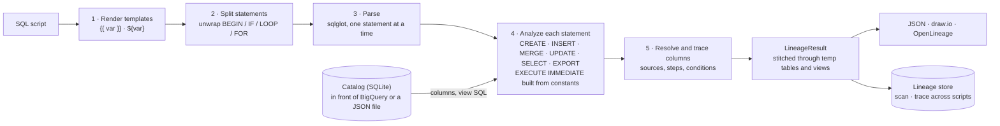

# How it works



1. **Render.** Template placeholders are filled from your variables ([variables.md](variables.md)).
2. **Split.** The script is split into statements, and procedural wrappers (`BEGIN`, `IF … THEN`, `LOOP`, `WHILE`, `FOR`, `CASE`, `EXCEPTION`) are peeled off, so the SQL inside blocks is analyzed like straight-line code.
3. **Parse.** sqlglot parses one statement at a time, so a syntax error in one doesn't stop the rest.
4. **Analyze.** Each statement is analyzed for what it writes and what it reads. Table schemas come from the [catalog](catalog.md).
5. **Resolve and trace.** Every column is matched to its table using the real schemas. Then its values are traced back to source columns, collecting each step's expression and JOIN / WHERE / GROUP BY.

The result stitches statements together, through temp tables and views, into the lineage you see ([output.md](output.md)).

## Modules

| Module | What it does |
|---|---|
| `analyzer.py` | `analyze()` and `validate()`. Walks a script statement by statement: what each one writes and reads, temp tables (versioned when re-created), script variables and constants, `EXECUTE IMMEDIATE` |
| `trace.py` | Column level. Resolves each column against real schemas, traces its values, collects each step's conditions, and explains resolution failures truthfully |
| `result.py` | `LineageResult`. Traces through temp tables and views, compacts one-to-one hops, produces the JSON |
| `script.py` | Splits a script into statements and unwraps procedural blocks |
| `render.py` | Fills template placeholders |
| `model.py` | The records: `Issue`, `StatementLineage`, `ColumnRecord`, and the JSON version number |
| `compat.py` | Every sqlglot internal bqlineage relies on, in one place |
| `catalog.py` | Schema providers: `DictSchemaProvider` (JSON), `BigQuerySchemaProvider`, the SQLite `Catalog` |
| `config.py` | `bqlineage.toml` plus flags, turned into settings and a schema provider |
| `scan.py` | Batch scans, the lineage store, `trace` across scripts |
| `drawio.py`, `openlineage.py` | Exports ([exports.md](exports.md)) |
| `cli.py` | The command line ([cli.md](cli.md)) |

## Principles

- **Never guess.** A column is attributed to a table only when that table's schema has it. If two tables have it, that's an error; if a schema is missing, it's a warning, and nothing is invented.
- **Keep going.** A bad statement doesn't stop the script, and an unresolvable column doesn't stop its statement. What couldn't be resolved is listed (`unresolved`, `issues`).
- **BigQuery's own rules.**
  - A name is a column if any source has it, otherwise a script variable.
  - `USING` keys merge both sides of the join.
  - Column names are case-insensitive; table names are not.
  - Views are traced to the tables they read.

## sqlglot

The SQL parser is [sqlglot](https://github.com/tobymao/sqlglot), pinned to 30.x in `pyproject.toml`.

- **Internals in one place.** bqlineage uses two sqlglot internals (`to_node` and the column `Resolver`) and works around two of its BigQuery behaviours. All four live in `compat.py`.
- **Canary tests.** `tests/test_compat.py` checks each assumption. After a sqlglot upgrade, a failure there names what changed; fix it in `compat.py`.

## Tests

```bash
.venv\Scripts\python -m pytest -q
```

No BigQuery access is needed: the BigQuery client is mocked. There is one test file per module, plus:

- **Golden tests** (`tests/golden/`): realistic scripts with their expected lineage checked in next to them. A change in output fails with a diff.
  - When a change is intended, run `pytest tests/test_golden.py --update-golden` and review `git diff tests/golden`.
  - To guard your own SQL, add an anonymized production script: put the `.sql` in that folder, add its tables to `schema.json`, regenerate, and check the new `.json` by hand before committing it.
- **Compatibility tests** (`tests/test_compat.py`): the sqlglot behaviours bqlineage depends on.
