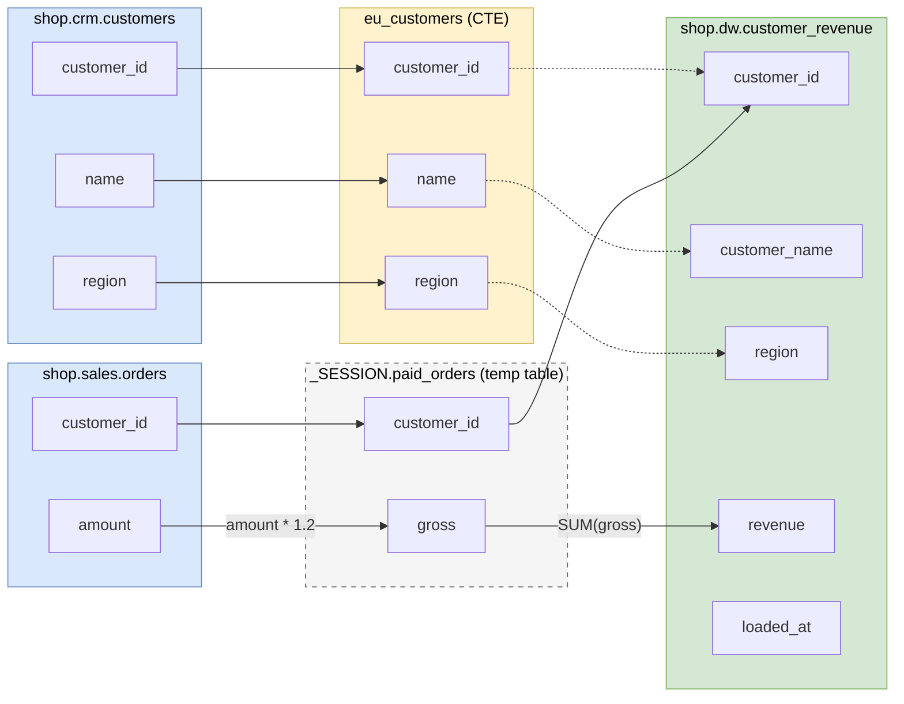

# Diagrams and OpenLineage

## draw.io

```bash
bqlineage lineage etl.sql --drawio lineage.drawio
```

The file opens in the [draw.io](https://www.drawio.com) desktop app, at [diagrams.net](https://app.diagrams.net), or in the VS Code draw.io extension. Pages are saved compressed, the way draw.io itself saves them. It has two pages; `--level` picks one or both:

- **Tables:** boxes flow left to right, from source tables through every intermediate step to the targets.
- **Columns:** each box lists only the columns in the lineage, with an arrow for every hop a value takes.

On both pages a source table sits just left of the first step that reads it, and each box lines up with what it connects to, so most arrows run straight. Arrows are drawn behind the boxes and never through one:

- a long arrow passes other columns of boxes in a lane kept free for it
- every bend sits in the gap between two columns, on a track of its own, so wires don't run on top of each other

A table the script writes (a target, a temp table, a view) lists its columns in the order they're written, and the boxes feeding it follow that order.

The diagram stays editable. Arrows are draw.io's own connectors, routed live, so dragging a table re-routes its arrows. An arrow with one bend, which is almost every arrow, keeps turning in its own track. Only a long arrow that needs two bends to get around boxes has fixed bend points. A table dragged onto another stays a table of its own, and its rows stay stacked.

### Driving and joined tables

A **solid** arrow comes from a step's driving table, the one that decides which rows the step has. A **dashed** grey arrow comes from a table that's joined in for more columns, or that only filters:

| Query | Solid (driving) | Dashed (joined in / filter) |
|---|---|---|
| `FROM a LEFT JOIN b`, `FROM a JOIN b` | `a` | `b` |
| `FROM a RIGHT JOIN b` | `b` | `a` |
| `FROM a FULL JOIN b` | `a` and `b` | |
| `FROM a CROSS JOIN b`, `FROM a, UNNEST(…)` | `a` | `b`, the `UNNEST` |
| `WHERE x IN (SELECT … FROM f)` | | `f` |
| `… UNION ALL …` | each branch's `FROM` | |

The rule carries through steps that only copy: in `WITH c AS (SELECT * FROM b) … LEFT JOIN c`, the arrow from `b` is dashed. Where a solid and a dashed arrow meet, the solid one is drawn on top.

### Intermediate steps

Each kind of step has its own style, with a legend at the top of each page:

| Box | Style | Hover shows |
|---|---|---|
| Source table | blue | |
| View (expanded from the catalog) | purple, dashed | each column's expression and `WHERE` |
| Temp table | grey, dashed | each column's expression and `WHERE` |
| CTE | yellow | the statement it belongs to; each column's step |
| Subquery (`FROM (SELECT …) s`) | orange, dotted | the statement it belongs to; each column's step |
| Target | green | each column's whole story: every step's expression with its JOIN / WHERE / GROUP BY, and the columns that decide its rows |

- **CTEs that only copy a column** (`c AS (SELECT * FROM t)`, no filter, join or expression) are left out, and the arrow goes straight past them. `--raw` draws them too.
- **Temp tables and views always show,** because they are steps the script wrote.
- **A `UNION` is always a step:** both branches feed the same box, and hovering a column shows one line per branch.
- **A table that only filters** (a `JOIN … ON` or `WHERE x IN (SELECT …)`) points at the step that reads it.
- **A CTE name used in two statements** gives two boxes; hover one to see which statement it belongs to.

The Columns page for the [worked example](output.md#a-worked-example) (file: [`examples/orders.drawio`](../examples/orders.drawio)):



`FROM paid_orders p JOIN eu_customers c` makes `paid_orders` the driving table (solid arrows), and `eu_customers` is joined in (dashed). Hovering `gross` in the temp table shows `gross = o.amount * 1.2`, `WHERE: o.status = 'PAID' AND …`. Hovering `revenue` shows that, plus the `SUM`, the JOIN and the GROUP BY that follow.

### Size

The Tables page stays small. The Columns page grows with the number of columns. For example, a script with 20 source tables, 10 temp tables and 5 targets of 200 columns each (1,000 target columns, each target built through a CTE) gives:

| What you export | File | Shapes | Arrows |
|---|---|---|---|
| Whole script, both pages | ~159 KB | 4,092 | 3,035 |
| `--table out0` | ~35 KB | 828 | 607 |
| `--table out0 --columns c0,c1` | ~3 KB | 31 | 13 |
| `--level table` | ~2 KB | 46 | 35 |

draw.io opens all of these, but past a few hundred columns the Columns page is too dense to read. So:

- use the Tables page for the overview
- use `--table` / `--columns` for the columns you care about
- in draw.io, *Arrange → Layout → Horizontal Flow* re-lays out a large diagram

## OpenLineage

[OpenLineage](https://openlineage.io) is the standard lineage format read by Marquez, DataHub and Google's Data Lineage API.

```bash
bqlineage lineage etl.sql --openlineage events.json
```

This writes one `RunEvent` for the script:

- **Inputs:** the tables it reads. Temp tables never appear.
- **Outputs:** the tables it writes, each with a `columnLineage` facet.
  - **`DIRECT` inputs** (where values come from) carry a subtype: `IDENTITY` (copied as is), `TRANSFORMATION`, or `AGGREGATION` (`SUM`, `COUNT`, …).
  - **`INDIRECT` inputs** are the columns that decide the rows.
- **Naming:** BigQuery tables are in namespace `bigquery` and named `project.dataset.table`. `EXPORT DATA` files are in `gs://bucket`.

### Publishing to Google's Data Lineage API

```bash
bqlineage publish events.json --project my-proj --region us
```

This sends the events to the Data Lineage API, so the lineage appears in the BigQuery and Dataplex lineage views next to the lineage BigQuery records itself. It needs:

- the Data Lineage API enabled in the project
- the Data Lineage Producer role (`roles/datalineage.producer`)
- the region the lineage should live in (`us`, `eu`, or a single region)

Writing events and publishing them are separate steps, so you can review what's sent.
