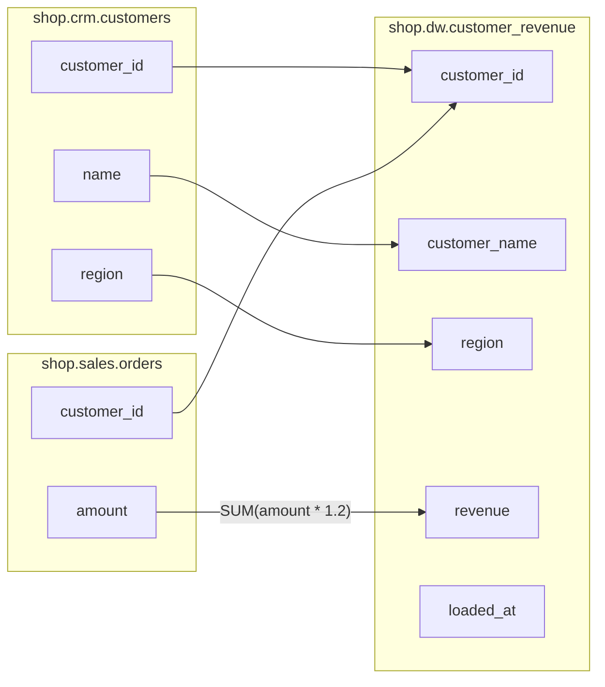

# Diagrams and OpenLineage

## draw.io

```bash
bqlineage lineage etl.sql --drawio lineage.drawio
```

The file opens in the [draw.io](https://www.drawio.com) desktop app, at [diagrams.net](https://app.diagrams.net), or in the VS Code draw.io extension. Pages are saved compressed, the way draw.io itself saves them. It has two pages; `--level` picks one or both:

- **Tables:** tables flow left to right, from sources to targets.
  - Sources are blue and targets green.
  - Temp tables and views are grey dashed (with `--raw`).
- **Columns:** each table lists only the columns in the lineage, in the target table's column order, with arrows from source column to target column. Source tables sit next to what they feed, so arrows run mostly straight.
  - **Hover a target column** to see how it was built: each step's expression with its JOIN / WHERE / GROUP BY, and the columns that decide its rows.

The Columns page for the [worked example](output.md#a-worked-example) (file: [`examples/orders.drawio`](../examples/orders.drawio)):



### Size

The Tables page stays small. The Columns page grows with the number of columns. For example, a script with 20 source tables, 10 temp tables and 5 targets of 200 columns each (1,000 target columns) gives:

| What you export | File | Shapes | Arrows |
|---|---|---|---|
| Whole script, both pages | ~62 KB | 2,050 | 1,020 |
| Whole script with `--raw` (temp hops) | ~115 KB | 4,100 | 2,550 |
| `--table out0` | ~13 KB | 410 | 204 |
| `--table out0 --columns a,b` | ~2 KB | 12 | 6 |
| `--level table` | ~1 KB | 25 | 20 |

draw.io opens all of these, but past a few hundred columns the Columns page is too dense to read. So:

- use the Tables page for the overview
- use `--table` / `--columns` for the columns you care about
- in draw.io, *Arrange → Layout → Horizontal Flow* re-lays out a large diagram

## OpenLineage

[OpenLineage](https://openlineage.io) is the standard lineage format read by Marquez, DataHub and Google's Data Lineage API.

```bash
bqlineage lineage etl.sql --openlineage events.json
```

This writes one `RunEvent` for the script:

- **Inputs:** the tables it reads. Temp tables never appear.
- **Outputs:** the tables it writes, each with a `columnLineage` facet.
  - **`DIRECT` inputs** (where values come from) carry a subtype: `IDENTITY` (copied as is), `TRANSFORMATION`, or `AGGREGATION` (`SUM`, `COUNT`, …).
  - **`INDIRECT` inputs** are the columns that decide the rows.
- **Naming:** BigQuery tables are in namespace `bigquery` and named `project.dataset.table`. `EXPORT DATA` files are in `gs://bucket`.

### Publishing to Google's Data Lineage API

```bash
bqlineage publish events.json --project my-proj --region us
```

This sends the events to the Data Lineage API, so the lineage appears in the BigQuery and Dataplex lineage views next to the lineage BigQuery records itself. It needs:

- the Data Lineage API enabled in the project
- the Data Lineage Producer role (`roles/datalineage.producer`)
- the region the lineage should live in (`us`, `eu`, or a single region)

Writing events and publishing them are separate steps, so you can review what's sent.
